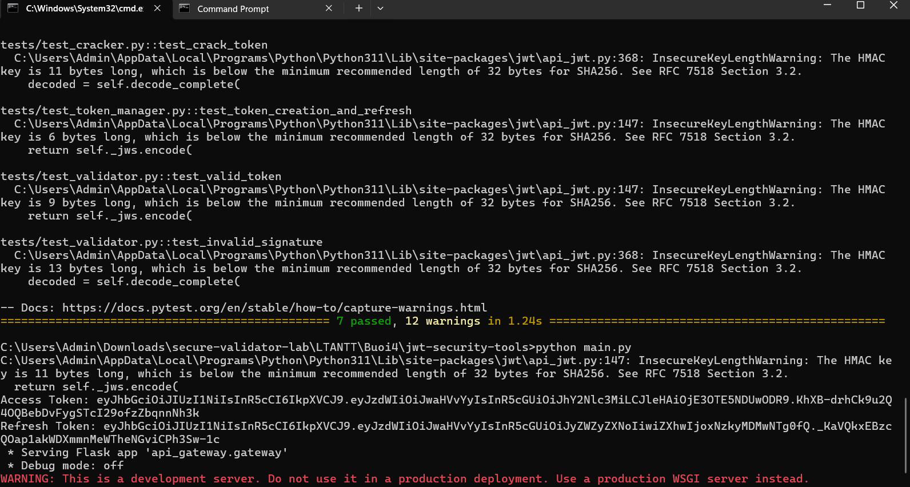
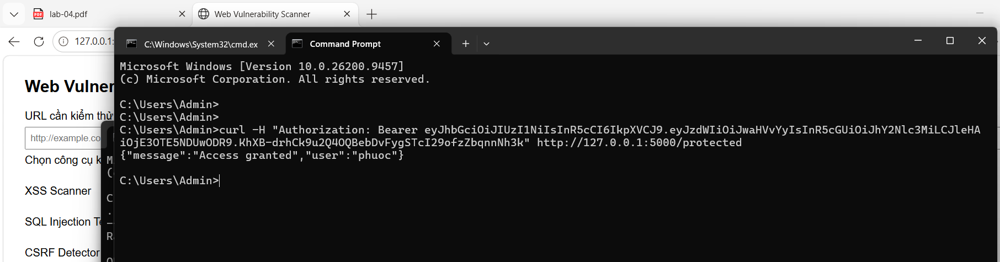

# Bài 4.4 – JWTSecure (Bộ công cụ bảo mật JWT)

Họ và tên: **Lê Viết Huy**
Lớp: **23DATA1**
MSSV: **2387700020**

---

## 1. Mục tiêu (4.4.1)

Xây dựng bộ công cụ bảo mật JWT gồm 5 thành phần:

| Thành phần | Chức năng |
|---|---|
| `JWTValidator` | Kiểm tra toàn diện tính hợp lệ và độ an toàn của JWT (chữ ký, hết hạn, token lỗi) |
| `JWTCracker` | Thử brute force khóa bí mật yếu dùng để ký JWT (đa luồng) |
| `OAuthClient` | Triển khai client OAuth 2.0 theo luồng Authorization Code chuẩn |
| `TokenManager` | Quản lý vòng đời JWT: phát hành access/refresh token, làm mới access token |
| `APIGateway` | Cổng API Flask có tích hợp xác thực bằng JWT (route `/protected`) |

## 2. Cơ sở lý thuyết JWT (tóm tắt – chi tiết xem báo cáo Buổi 4)

JWT có cấu trúc 3 phần ngăn cách bởi dấu chấm: `<Header>.<Payload>.<Signature>`.

- **Header**: khai báo thuật toán ký (`alg`, vd `HS256`) và loại token (`typ: JWT`).
- **Payload**: chứa các claim như `sub` (định danh người dùng), `iat` (phát hành), `exp` (hết hạn), `iss` (bên phát hành). Payload chỉ được **base64**, không mã hóa.
- **Signature**: `HMACSHA256(base64Url(header) + "." + base64Url(payload), secret)` – dùng xác minh tính toàn vẹn.

Các lỗ hổng JWT phổ biến mà bộ công cụ này nhắm tới:

| Lỗ hổng | Mô tả | Thành phần phòng/khai thác |
|---|---|---|
| `alg=none` | Thư viện chấp nhận `alg=none` → bỏ qua chữ ký | `JWTValidator` chỉ nhận `algorithms=["HS256"]` |
| Key confusion (HS256 vs RS256) | Chuyển bất đối xứng → đối xứng để giả mạo bằng public key | Cố định thuật toán khi `decode` |
| Brute force secret | Khóa bí mật quá yếu bị dò bằng từ điển | `JWTCracker` minh họa rủi ro này |
| Token replay | Dùng lại token đã hết hạn / bị đánh cắp | `TokenManager` đặt `exp` ngắn cho access token |
| Lỗi xác thực thời gian (`exp`) | Không kiểm tra `exp` → token dùng vô hạn | `JWTValidator` bắt `ExpiredSignatureError` |
| Thông tin nhạy cảm trong Payload | Payload chỉ base64 → đọc được nếu bị lộ | Không đặt dữ liệu nhạy cảm vào payload |

## 3. Cấu trúc thư mục

```
jwt-security-tools/
├── main.py                   phát hành token mẫu + chạy API Gateway
├── requirements.txt          PyJWT, requests, flask, pytest
├── pytest.ini                pythonpath = .
├── api_gateway/
│   └── gateway.py            APIGateway – Flask, route /protected
├── jwt_cracker/
│   └── cracker.py            JWTCracker – brute force đa luồng
├── jwt_validator/
│   └── validator.py          JWTValidator – kiểm tra chữ ký/hết hạn
├── oauth_client/
│   └── client.py             OAuthClient – Authorization Code flow
├── token_manager/
│   └── manager.py            TokenManager – access/refresh token
└── tests/                    7 test
    ├── test_api_gateway.py   (2)  test_cracker.py        (1)
    ├── test_oauth_client.py  (1)  test_token_manager.py  (1)
    └── test_validator.py     (2)
```

*(mỗi thư mục con đều có `__init__.py` để import theo package.)*

## 4. Cài đặt và chạy

Mở terminal tại thư mục `jwt-security-tools`:

```bash
python -m pip install -r requirements.txt
```

### 4.1. Chạy kiểm thử (pytest) và chương trình chính

Chạy lần lượt trong cùng một cửa sổ terminal:

```bash
pytest tests/
python main.py
```

- `pytest tests/` → **`7 passed`** (kèm vài cảnh báo không ảnh hưởng):

  ```
  collected 7 items
  tests/test_api_gateway.py ..
  tests/test_cracker.py .
  tests/test_oauth_client.py .
  tests/test_token_manager.py .
  tests/test_validator.py ..
  7 passed, ... warnings
  ```

- `python main.py` → in **Access Token** và **Refresh Token**, rồi khởi động API Gateway tại `http://127.0.0.1:5000`:

  ```
  Access Token: eyJhbGciOiJIUzI1NiIsInR5cCI6IkpXVCJ9...
  Refresh Token: eyJhbGciOiJIUzI1NiIsInR5cCI6IkpXVCJ9...
   * Serving Flask app 'api_gateway.gateway'
   * Running on http://127.0.0.1:5000
  ```



### 4.2. Kiểm tra chứng thực bằng `curl`

Mở một Command Prompt **khác** (giữ `main.py` đang chạy), dán Access Token vừa lưu:

```bash
curl -H "Authorization: Bearer <access_token>" http://127.0.0.1:5000/protected
```

- Token hợp lệ → `{"message":"Access granted","user":"phuoc"}`
- Token sai (`Bearer invalid`) → HTTP 401 `{"message":"Access denied"}`



## 5. Giải thích nhanh từng thành phần

- **TokenManager** (`manager.py`): `generate_tokens(user_id)` tạo cặp access (hạn 15 phút) + refresh (hạn 24 giờ); `refresh_access_token(refresh)` kiểm tra `type == "refresh"` rồi cấp access token mới. Minh họa vòng đời token ở mục lý thuyết 4.3.3.
- **APIGateway** (`gateway.py`): route `/protected` lấy `Authorization: Bearer ...`, `jwt.decode` với đúng `secret` + `algorithms`; hợp lệ trả *Access granted*, lỗi trả 401.
- **JWTValidator** (`validator.py`): tách riêng từng loại lỗi – hết hạn (`Token expired`), sai chữ ký (`Invalid signature`), token hỏng (thông điệp lỗi gốc).
- **JWTCracker** (`cracker.py`): đọc wordlist, dùng `ThreadPoolExecutor(max_workers=10)` thử song song; trả về secret đầu tiên `jwt.decode` thành công → chứng minh **secret yếu rất dễ bị dò**.
- **OAuthClient** (`client.py`): `get_auth_url()` dựng URL Authorization Code (`response_type=code`); `get_token(code)` đổi code lấy access token qua `grant_type=authorization_code`.

## 6. Lưu ý khi commit (GitSecure) & đạo đức

- Code mẫu đặt secret trực tiếp trong `main.py` và trong các file test (vd `secret = "supersecret"`). Nếu repo có hook quét bí mật (GitSecure/pre-commit) thì các dòng dạng `secret = "..."` có thể **bị chặn commit**. Cách xử lý đúng chuẩn bảo mật: đọc secret từ biến môi trường, ví dụ trong `main.py`:

  ```python
  import os
  secret = os.environ.get("JWT_SECRET", "supersecret")
  ```

  (các giá trị trong file test chỉ là dữ liệu kiểm thử cục bộ, không phải secret thật.)
- `JWTCracker` **chỉ** được dùng để dò khóa của **token do chính mình tạo** nhằm mục đích học tập, minh họa rủi ro của secret yếu. Không dùng để tấn công token/khóa của hệ thống không thuộc sở hữu hoặc chưa được phép.
- Không đặt thông tin nhạy cảm (mật khẩu, số thẻ…) vào payload JWT vì payload chỉ được base64, ai cũng giải mã đọc được.

---

> **Ảnh minh họa (ảnh chụp màn hình thật) trong `images/`:** `01_test_run.png` (pytest `7 passed` + main.py in token), `02_curl.png` (xác thực `/protected` bằng curl → Access granted).
