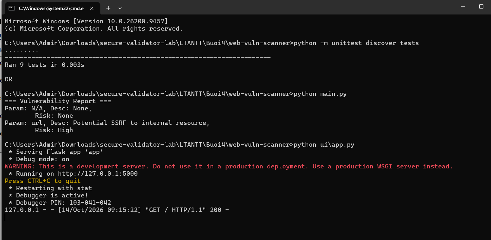
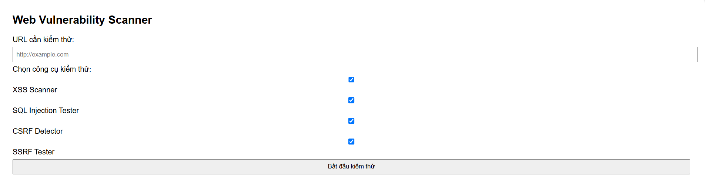
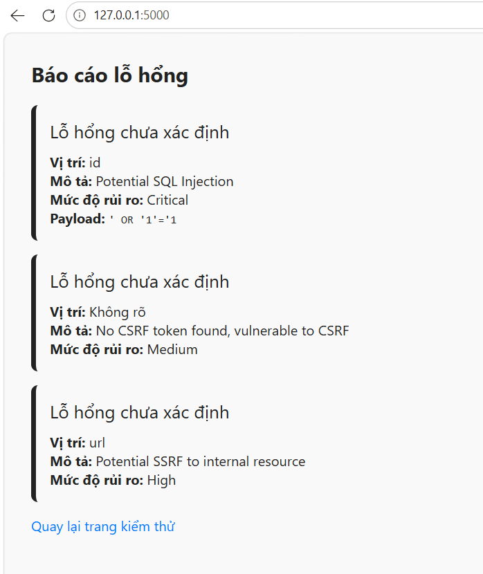

# Bài 4.2 – Web Vulnerability Scanner

Họ và tên: **Lê Viết Huy**
Lớp: **23DATA1**
MSSV: **2387700020**

---

## 1. Mục tiêu (4.2.1)

Xây dựng công cụ **Web Vulnerability Scanner** gồm 5 thành phần:

| Thành phần | Chức năng |
|---|---|
| `XSSScanner` | Phát hiện XSS bằng thư viện payload đã chuẩn hoá, gửi payload và kiểm tra phản hồi |
| `SQLInjectionTester` | Kiểm thử các biến thể SQL Injection trên tham số URL |
| `CSRFDetector` | Phân tích HTML, kiểm tra có token chống CSRF hay không |
| `SSRFTester` | Phát hiện tham số trỏ tới địa chỉ nội bộ (SSRF) |
| `ReportGenerator` | Gom kết quả các scanner thành một báo cáo thống nhất |

## 2. Cơ sở lý thuyết (tóm tắt)

- **XSS (Cross-Site Scripting):** chèn mã JavaScript vào trang để thực thi trên trình duyệt nạn nhân (đánh cắp cookie/session). Công cụ gửi payload như `<script>alert(1)</script>` rồi kiểm tra payload có bị phản hồi nguyên vẹn trong trang không.
- **SQL Injection:** chèn mã SQL vào tham số đầu vào để can thiệp truy vấn. Công cụ dò các payload kinh điển (`' OR '1'='1`, `' UNION SELECT NULL--`...) trong tham số URL.
- **CSRF (Cross-Site Request Forgery):** ép trình duyệt người dùng đã đăng nhập thực hiện hành động ngoài ý muốn. Biện pháp cơ bản là **CSRF token**; công cụ kiểm tra form có trường `csrf_token` / `_csrf` / `csrfmiddlewaretoken` không.
- **SSRF (Server-Side Request Forgery):** ép server gửi request tới tài nguyên nội bộ (`127.0.0.1`, `localhost`, `10.x`, `192.168.x`, `172.16–31.x`). Công cụ dò các dải IP nội bộ này trong tham số URL.

## 3. Cấu trúc thư mục

```
web-vuln-scanner/
├── main.py                       chạy thử toàn bộ scanner trên 1 URL mẫu
├── requirements.txt              Flask
├── __init__.py
├── scanners/
│   ├── xss_scanner.py            XSSScanner  (requests)
│   ├── sql_injection_tester.py   SQLInjectionTester (urllib.parse)
│   ├── csrf_detector.py          CSRFDetector (regex)
│   └── ssrf_tester.py            SSRFTester  (regex dải IP nội bộ)
├── report/
│   └── report_generator.py       ReportGenerator
├── tests/                        9 unit test
│   ├── test_xss.py  test_sql_injection.py  test_csrf.py
│   ├── test_ssrf.py  test_report.py
└── ui/
    ├── app.py                    web Flask: form chọn scanner + trang kết quả
    └── templates/
        ├── index.html            form nhập URL + chọn công cụ
        └── result.html           trang "Báo cáo lỗ hổng"
```

## 4. Cài đặt và chạy

Mở terminal tại thư mục `web-vuln-scanner`:

```bash
python -m pip install -r requirements.txt   # Flask (và requests)
```

### 4.1. Chạy unit test, chương trình chính và server web

Chạy lần lượt 3 lệnh trong cùng một cửa sổ terminal:

```bash
python -m unittest discover tests
python main.py
python ui/app.py
```

- `python -m unittest discover tests` → **`Ran 9 tests ... OK`** (9 test gồm XSS, SQLi×2, CSRF×2, SSRF×2, Report×2).
- `python main.py` → in `=== Vulnerability Report ===` gồm mục CSRF (form mẫu có token) và một cảnh báo **SSRF** (tham số `url` trỏ `127.0.0.1`):

  ```
  === Vulnerability Report ===
  Param: N/A, Desc: None, Risk: None
  Param: url, Desc: Potential SSRF to internal resource, Risk: High
  ```

- `python ui/app.py` → server web chạy tại `http://127.0.0.1:5000` (debug mode).



### 4.2. Giao diện web

Mở trình duyệt vào `http://127.0.0.1:5000/`, nhập URL cần kiểm thử, chọn các công cụ rồi bấm **Bắt đầu kiểm thử**:



Để minh họa công cụ bắt được nhiều loại lỗ hổng, nhập URL sau rồi tick cả 4 công cụ:

```
http://example.com/page?id=' OR '1'='1&url=http://127.0.0.1/admin
```

Kết quả ra **3 lỗ hổng**: **SQL Injection** (tham số `id`, Critical) + **SSRF** (tham số `url`, High) + **CSRF** (Medium).

**Lưu ý cơ chế từng scanner:**
- `SQLInjectionTester` và `SSRFTester` là bộ *dò mẫu*: chỉ báo khi URL **đã chứa sẵn** payload SQL / IP nội bộ trong tham số (không tự tấn công) — nên URL trên mới ra kết quả; URL "sạch" như `example.com` sẽ không có.
- `CSRFDetector` xét một form cố định không có token nên luôn báo thiếu CSRF token (Medium).
- `XSSScanner` **chủ động gửi** 2 payload `<script>alert(1)</script>` và `'><svg/onload=alert(1)>` vào tham số `q` rồi kiểm tra trang có phản hồi lại không. Nó chỉ báo XSS khi quét một trang **phản hồi lại payload** — ví dụ trang cố ý lỗi `http://testphp.vulnweb.com/artists.php?artist=1'` (cần máy truy cập được testphp); với trang bình thường thì XSS không ra cảnh báo.

Trang kết quả hiển thị từng lỗ hổng theo màu mức độ rủi ro (HIGH/MEDIUM/LOW), kèm vị trí, mô tả, URL và payload:



## 5. Ghi chú đạo đức & trang kiểm thử

Chỉ kiểm thử trên **máy của chính mình** (`127.0.0.1`) hoặc các **trang test công khai được phép quét**:

- `http://testphp.vulnweb.com/artists.php?artist=1'` (Acunetix – site cố ý lỗi để test)
- `https://xss-game.appspot.com/level1` (Google XSS training)
- `http://testphp.vulnweb.com/showimage.php?file=1`
- Payload mẫu: `' OR '1'='1`, `" OR "1"="1`, `1'; --`
- `https://webhook.site` → lấy URL ngẫu nhiên để test SSRF/OOB.

Không quét các hệ thống/IP không thuộc sở hữu hoặc chưa được phép.

## 6. Ghi chú kỹ thuật

- `XSSScanner` phụ thuộc `requests`; `main.py` dùng URL mẫu `http://example.com/...` (không phản hồi payload) nên phần XSS/SQLi trong `main.py` không ra cảnh báo — đúng như kết quả mẫu. Khi quét site test thật qua web UI thì XSS sẽ có cảnh báo.
- `CSRFDetector.scan()` trả về `{'csrf_protected': True}` khi form có token; `ReportGenerator` vẫn đưa dict này vào báo cáo nên hiện dòng `Param: N/A, Desc: None`.
- Thư mục `__pycache__` sinh khi chạy đã nằm trong `.gitignore`, không commit.

---

> **Ảnh minh họa (ảnh chụp màn hình thật) trong `images/`:** `01_terminal.png` (unittest + main.py + Flask trong cùng terminal), `02_web_form.png` (giao diện web), `03_web_result.png` (báo cáo 3 lỗ hổng).
