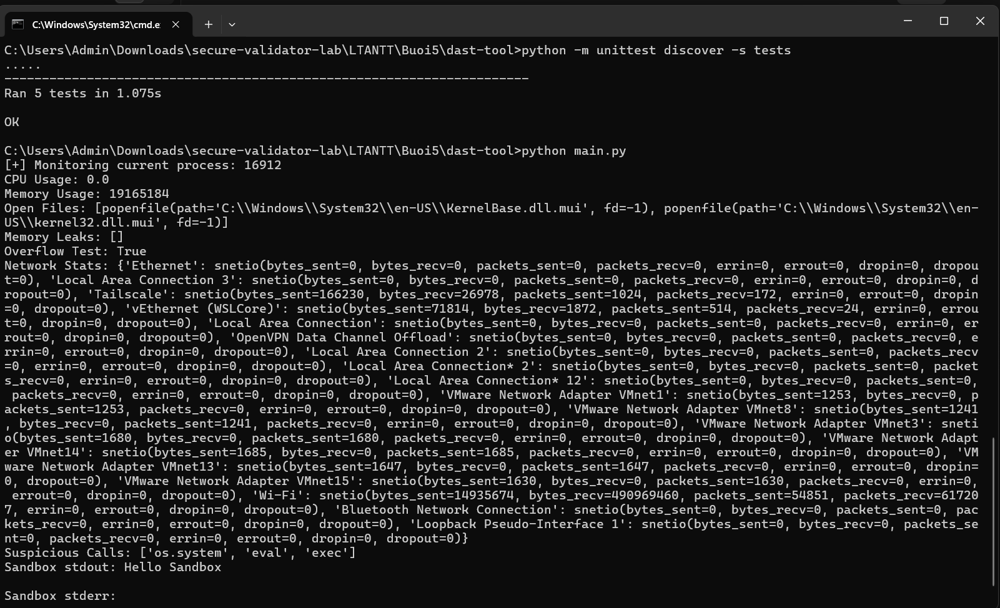
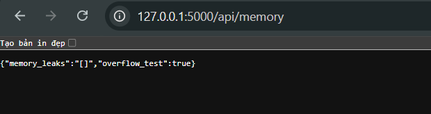

# Bài 5.4 – DAST-TOOL (Phân tích bảo mật động)

Họ và tên: **Lê Viết Huy**
Lớp: **23DATA1**
MSSV: **2387700020**

---

## 1. Mục tiêu

Xây dựng nền tảng phân tích **động** (DAST) – giám sát hành vi ứng dụng khi thực thi, gồm 5 thành phần và một API Flask để truy vấn:

| Thành phần | Chức năng |
|---|---|
| `RuntimeMonitor` | Giám sát tiến trình: CPU, bộ nhớ (RSS), file đang mở |
| `MemoryAnalyzer` | Phát hiện rò rỉ bộ nhớ (qua `gc`) và tràn số nguyên cơ bản |
| `NetworkTrafficAnalyzer` | Thống kê lưu lượng mạng theo từng card (`psutil`) |
| `SecurityBehaviorChecker` | Dò các lời gọi nghi ngờ (`os.system`, `eval`, `exec`) trong mã |
| `VirtualSandbox` | Chạy lệnh trong thư mục tạm cách ly rồi thu stdout/stderr |

## 2. Vì sao cần phân tích động

Phân tích tĩnh chỉ thấy mã nguồn; nhiều vấn đề **chỉ lộ ra khi chạy**:

- Tiêu thụ tài nguyên bất thường (CPU/bộ nhớ tăng đột biến) → dấu hiệu lỗi logic hoặc tấn công.
- Rò rỉ bộ nhớ, tràn số → gây sập hoặc hành vi không xác định.
- Kết nối mạng ngoài ý muốn → dấu hiệu exfiltration hoặc kết nối C2.
- Hành vi nguy hiểm phát sinh lúc runtime (gọi lệnh hệ thống, thực thi mã động).

## 3. Cấu trúc thư mục

```
dast-tool/
├── runtime_monitor.py             RuntimeMonitor
├── memory_analyzer.py             MemoryAnalyzer
├── network_traffic_analyzer.py    NetworkTrafficAnalyzer
├── security_behavior_checker.py   SecurityBehaviorChecker
├── virtual_sandbox.py             VirtualSandbox
├── main.py                        chạy thử toàn bộ trên tiến trình hiện tại
├── app.py                         Flask API (5 endpoint)
├── requirements.txt               psutil, Flask
└── tests/                         5 unit test
```

## 4. Cài đặt và chạy

Mở terminal tại thư mục `dast-tool`:

```bash
python -m pip install -r requirements.txt
```

### 4.1. Unit test

```bash
python -m unittest discover -s tests
```

Kết quả mong đợi: **`Ran 5 tests ... OK`**.

### 4.2. Chạy giám sát trực tiếp

```bash
python main.py
```

In thông tin giám sát tiến trình hiện tại: CPU, bộ nhớ, file mở, kết quả overflow (`True`), thống kê mạng, các lời gọi nghi ngờ (`['os.system', 'eval', 'exec']`) và kết quả sandbox (`Hello Sandbox`).



### 4.3. Chạy API Flask

```bash
python app.py
```

Server chạy tại `http://127.0.0.1:5000`. Các endpoint:

- `GET /api/monitor` – CPU, bộ nhớ, file đang mở.
- `GET /api/memory` – rò rỉ bộ nhớ, kết quả overflow.
- `GET /api/network` – thống kê mạng theo card.
- `GET /api/security` – các lời gọi nghi ngờ.
- `POST /api/sandbox` – chạy lệnh trong sandbox, body JSON `{"command": "..."}`.

Mở trình duyệt vào các endpoint `GET` (vd `http://127.0.0.1:5000/api/memory`); endpoint `POST` kiểm tra bằng:

```bash
curl -X POST http://127.0.0.1:5000/api/sandbox -H "Content-Type: application/json" -d "{\"command\": \"echo Hello API\"}"
```



## 5. Giải thích từng thành phần

- `RuntimeMonitor(pid)`: bọc `psutil.Process(pid)`; `cpu_percent(interval=1.0)`, `memory_info().rss`, `open_files()`.
- `MemoryAnalyzer`: `check_memory_leaks()` ép `gc.collect()` rồi lọc đối tượng còn `__del__` trong `gc.garbage`; `check_overflow(value)` báo `True` khi số nguyên vượt `2**63`.
- `NetworkTrafficAnalyzer.get_network_stats()`: trả `psutil.net_io_counters(pernic=True)` (dict theo từng card mạng).
- `SecurityBehaviorChecker.suspicious_calls()`: đọc chính file mã, dò các chuỗi `os.system`, `eval`, `exec`.
- `VirtualSandbox.run_isolated(command)`: tạo thư mục tạm bằng `tempfile.mkdtemp()` rồi chạy lệnh với `cwd` là thư mục đó, thu `stdout`/`stderr`.

## 6. Lưu ý an toàn

- `VirtualSandbox` dùng `subprocess.run(..., shell=True)` và endpoint `POST /api/sandbox` cho phép chạy lệnh tùy ý → bản chất là **thực thi lệnh từ xa**. Chỉ dùng cho mục đích học tập trong môi trường cô lập; **không** triển khai thật. Sandbox ở đây chỉ cách ly thư mục làm việc, không cách ly toàn hệ thống như VM/container thật.
- `app.run(host="0.0.0.0")` mở API ra mọi card mạng; nên đổi về `127.0.0.1` khi chạy để tránh lộ ra ngoài.
- Việc đọc file mã để dò lời gọi nghi ngờ là minh họa; phân tích động thật cần hook syscall/giám sát tiến trình ở mức hệ điều hành.
