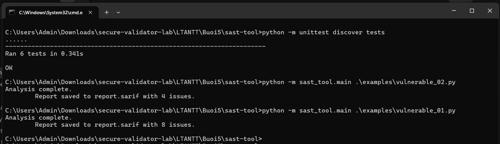
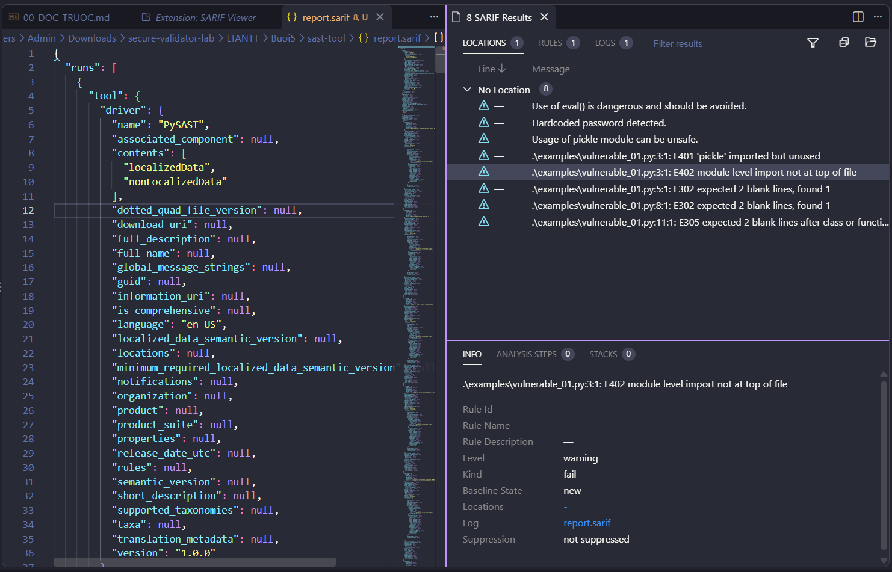

# Bài 5.2 – SAST-TOOL (Phân tích bảo mật tĩnh)

Họ và tên: **Lê Viết Huy**
Lớp: **23DATA1**
MSSV: **2387700020**

---

## 1. Mục tiêu

Xây dựng công cụ phân tích bảo mật **tĩnh** (SAST) cho mã nguồn Python, gồm 5 thành phần:

| Thành phần | Chức năng |
|---|---|
| `ASTAnalyzer` | Duyệt cây cú pháp (AST) phát hiện lời gọi nguy hiểm như `eval` |
| `VulnPatternMatcher` | Dò lỗ hổng theo mẫu regex (hardcoded password, `import pickle`) |
| `SecurityRuleEngine` | Gán mức độ nghiêm trọng cho lỗ hổng theo bộ luật cấu hình được |
| `CodeQualityChecker` | Đánh giá chất lượng mã bằng `flake8` (lint) |
| `SarifReporter` | Xuất báo cáo theo chuẩn **SARIF** để xem bằng công cụ chuyên dụng |

## 2. Lỗ hổng phát hiện và nguyên nhân kỹ thuật

- **Dùng `eval()` / `exec()`** (ASTAnalyzer): `eval` thực thi chuỗi như mã Python. Nếu chuỗi chứa dữ liệu người dùng, kẻ tấn công chèn mã tùy ý → **thực thi mã từ xa (RCE)**. Root cause: trộn lẫn *dữ liệu* và *mã lệnh*.
- **Hardcoded password** (VulnPatternMatcher): mật khẩu/khóa viết thẳng trong mã bị lộ cho bất kỳ ai đọc được mã (hoặc lịch sử Git) → **rò rỉ thông tin xác thực**. Root cause: bí mật nằm trong mã nguồn thay vì cấu hình bên ngoài.
- **`import pickle`** (VulnPatternMatcher): `pickle` giải tuần tự dữ liệu có thể khôi phục đối tượng tùy ý; nạp dữ liệu không tin cậy → **insecure deserialization → RCE**. Root cause: tin tưởng dữ liệu serialize từ nguồn ngoài.
- **Lint Issue** (CodeQualityChecker): mã không tuân chuẩn (import thừa, import không ở đầu file, thiếu dòng trống) phản ánh chất lượng thấp, làm tăng nguy cơ bỏ sót lỗi và lỗ hổng.

## 3. Cấu trúc thư mục

```
sast-tool/
├── main.py                        (không dùng trực tiếp – chạy qua -m)
├── requirements.txt               flake8, sarif-om, jsonpickle
├── examples/
│   ├── vulnerable_01.py           ví dụ: eval + password + pickle
│   └── vulnerable_02.py           ví dụ: eval + exec
├── rules/
│   └── default_rules.json         bộ luật: Use of eval / Pattern Match / Lint Issue
├── sast_tool/
│   ├── ast_analyzer.py            ASTAnalyzer
│   ├── vuln_pattern_matcher.py    VulnPatternMatcher
│   ├── security_rule_engine.py    SecurityRuleEngine
│   ├── code_quality_checker.py    CodeQualityChecker
│   ├── sarif_reporter.py          SarifReporter
│   └── main.py                    điều phối toàn bộ, xuất report.sarif
└── tests/                         6 unit test
```

## 4. Cài đặt và chạy

Mở terminal tại thư mục `sast-tool`:

```bash
python -m pip install -r requirements.txt
```

### 4.1. Unit test

```bash
python -m unittest discover tests
```

Kết quả mong đợi: **`Ran 6 tests ... OK`** (AST, Pattern×2, RuleEngine, Lint, SARIF).

### 4.2. Phân tích file và xuất SARIF

```bash
python -m sast_tool.main .\examples\vulnerable_01.py
python -m sast_tool.main .\examples\vulnerable_02.py
```

Kết quả: in `Analysis complete.` và số lỗ hổng, đồng thời ghi `report.sarif`:

- `vulnerable_01.py` → **8 issues** (1 eval + 2 pattern + 5 lint).
- `vulnerable_02.py` → **4 issues** (1 eval + 3 lint).



### 4.3. Xem báo cáo SARIF

Cài extension **SARIF Viewer** trong Visual Studio Code rồi mở `report.sarif` để xem danh sách lỗ hổng kèm vị trí dòng/cột:



## 5. Giải thích từng thành phần

- `ASTAnalyzer.analyze(code)`: `ast.parse` → `ast.walk`, với mỗi `ast.Call` có `func.id == 'eval'` ghi nhận 1 lỗ hổng kèm `lineno`/`col_offset`.
- `VulnPatternMatcher.match(code)`: dùng `re.finditer` với 2 mẫu (`password\s*=\s*".*"`, `import\s+pickle`), tính dòng/cột từ vị trí khớp.
- `SecurityRuleEngine.evaluate(...)`: với mỗi lỗ hổng, nếu `type` khớp một luật trong `default_rules.json` thì gán `severity` tương ứng (eval→high, Pattern→medium, Lint→low).
- `CodeQualityChecker.check(filepath)`: gọi `flake8` qua `subprocess`, tách từng dòng kết quả thành `lineno`/`col_offset`/thông điệp.
- `SarifReporter.generate_report(...)`: dựng `SarifLog` (tool PySAST 1.0.0), mỗi lỗ hổng là một `Result` có `Region(start_line, start_column)`, ghi ra file bằng `jsonpickle`.

## 6. Biện pháp phòng chống

- Không dùng `eval`/`exec` trên dữ liệu người dùng; nếu cần parse hằng thì dùng `ast.literal_eval`; hoặc whitelist thao tác cho phép.
- Không hardcode mật khẩu/khóa trong mã; dùng biến môi trường hoặc trình quản lý bí mật (vault), và không commit secret lên Git.
- Tránh `pickle` với dữ liệu không tin cậy; ưu tiên `json`; nếu buộc dùng thì ký (HMAC) và kiểm tra toàn vẹn trước khi nạp.
- Bật linter (flake8) trong quy trình CI để chặn mã kém chất lượng ngay từ khi commit.
