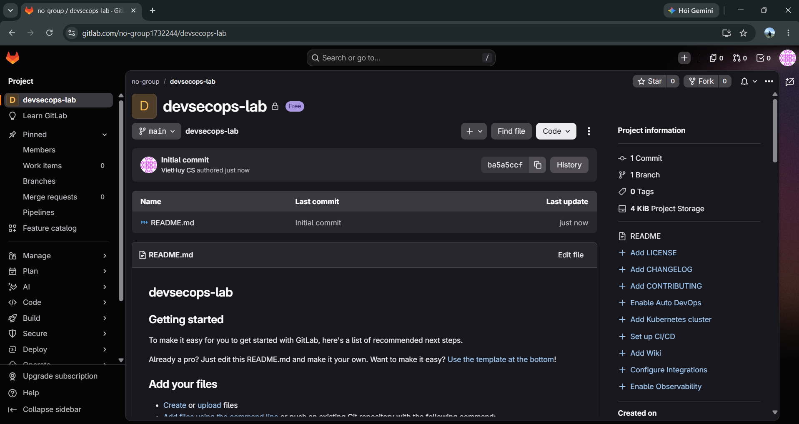
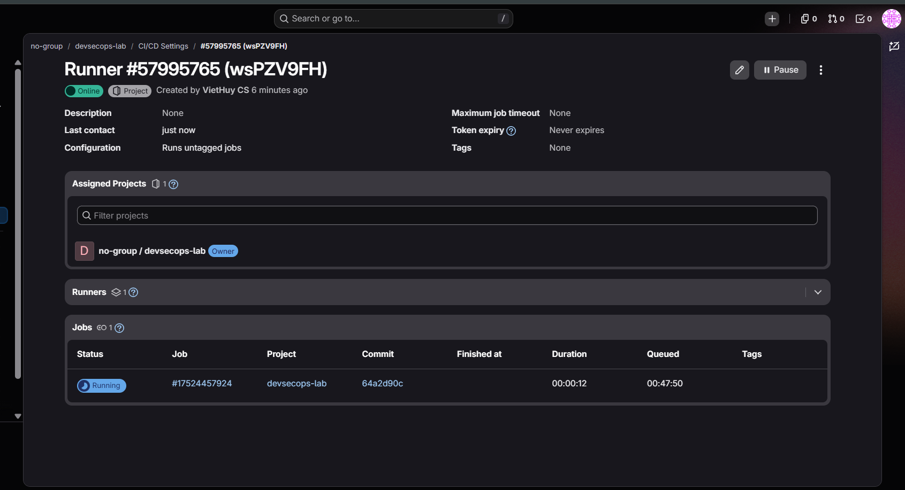
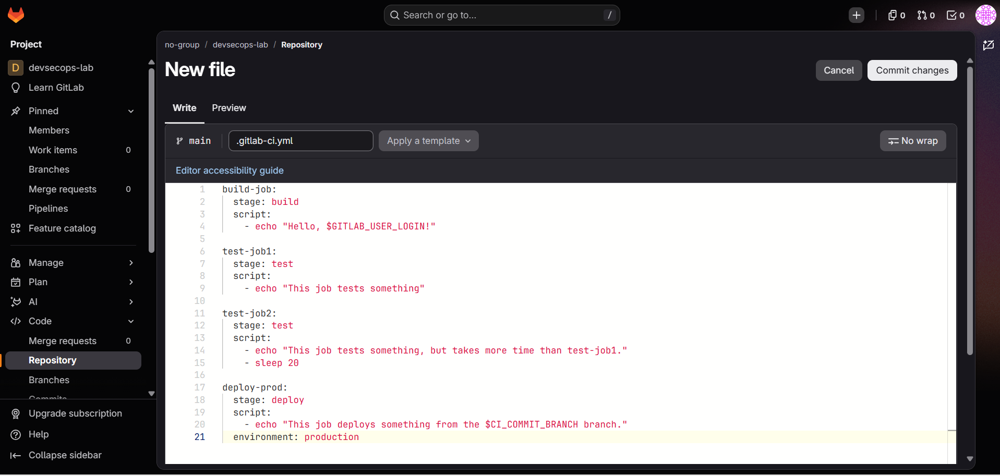
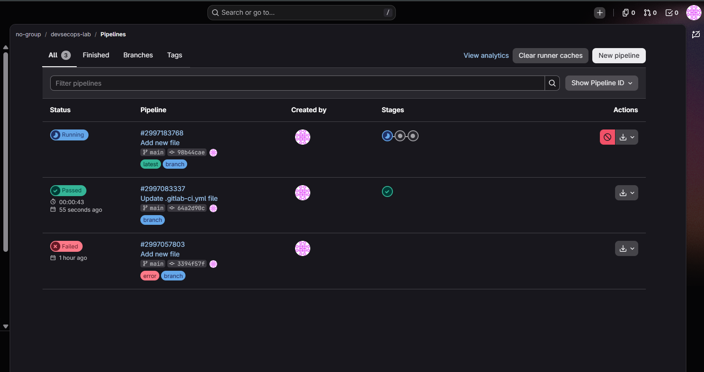
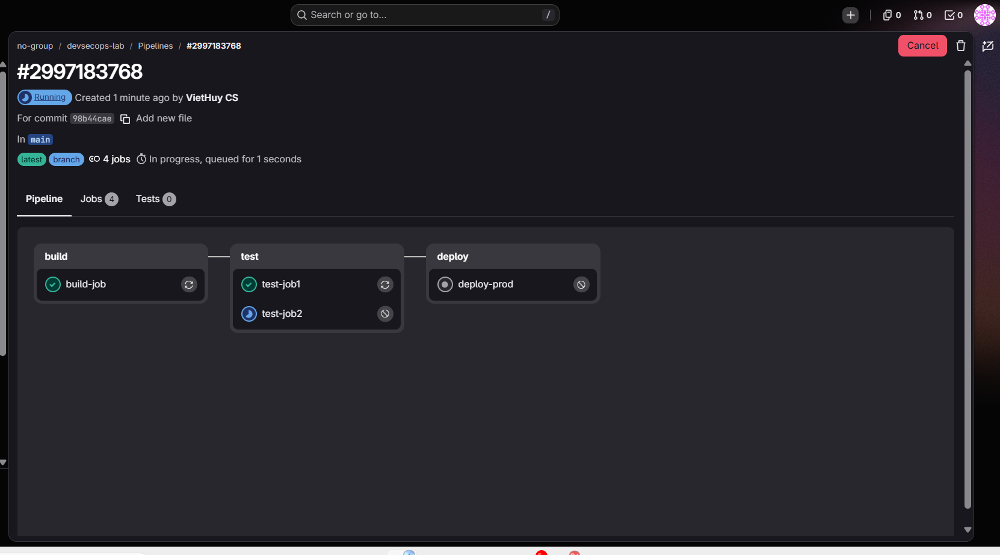
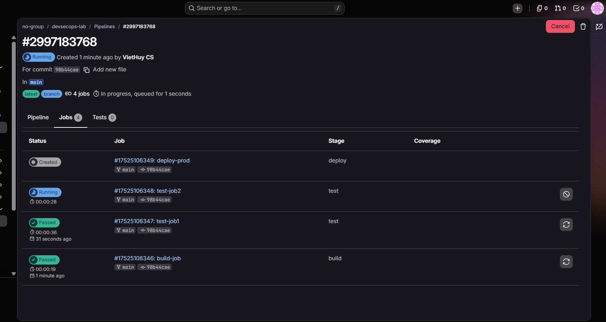
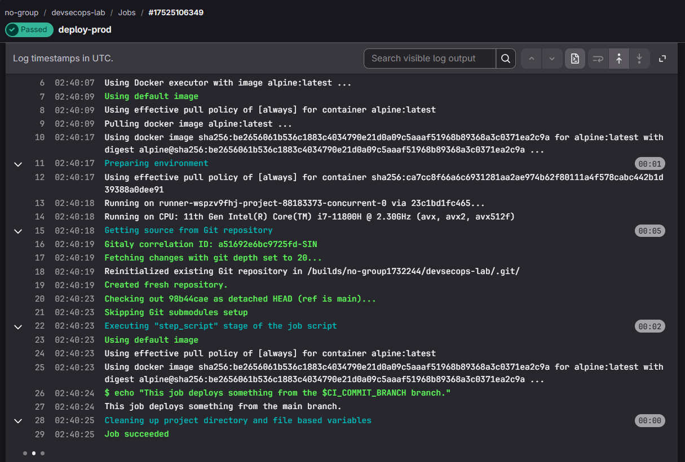

<div align="center">

# BÁO CÁO THỰC HÀNH
## BÀI 6: BẢO MẬT VỚI DEVSECOPS

**Môn học:** Lập trình An ninh thông tin

</div>

| Thông tin | |
|---|---|
| **Họ tên sinh viên** | Lê Viết Huy |
| **Ngày thực hiện** | 28/10/2026 |
| **Mã nguồn** | [`Buoi6/`](.) trong repo [vhuy811/LTANTT](https://github.com/vhuy811/LTANTT) |

---

## Mục lục
1. [Mục tiêu và môi trường](#1-mục-tiêu-và-môi-trường)
2. [Cơ sở lý thuyết](#2-cơ-sở-lý-thuyết)
3. [Thực hành 6.2.1 – Pipeline cơ bản](#3-thực-hành-621--pipeline-cơ-bản)
4. [Thực hành 6.2.2 – Docusaurus và GitLab Pages](#4-thực-hành-622--docusaurus-và-gitlab-pages)
5. [Kết quả, phân tích và đánh giá](#5-kết-quả-phân-tích-và-đánh-giá)
6. [Mở rộng DevSecOps: security gate](#6-mở-rộng-devsecops-security-gate)
7. [Kết luận](#7-kết-luận)
8. [Tài liệu tham khảo](#8-tài-liệu-tham-khảo)

---

## 1. Mục tiêu và môi trường

**Mục tiêu**
- Hiểu cách tích hợp bảo mật vào CI/CD theo tinh thần DevSecOps.
- Tạo và chạy pipeline GitLab CI/CD với stage, job, runner; đọc log job.
- Build website Docusaurus, lưu artifact và triển khai lên GitLab Pages.

**Môi trường**

| Thành phần | Cấu hình |
|---|---|
| Nền tảng | GitLab.com, project `devsecops-lab` (gói Free) |
| Runner | Project runner, executor **Docker**, chạy bằng Docker Desktop trên máy cá nhân |
| Image mặc định | `alpine:latest` (6.2.1), `node:22` (6.2.2) |
| Ứng dụng | Docusaurus (classic, TypeScript) |

> Shared runner của GitLab.com yêu cầu xác minh thẻ thanh toán, nên bài làm dùng **runner tự đăng ký** cho project.

## 2. Cơ sở lý thuyết

### 2.1 Thiết kế pipeline an toàn

| Thành phần | Nội dung chính |
|---|---|
| Kiểm soát truy cập | Bật MFA, phân quyền tối thiểu |
| Quản lý bí mật | Không ghi khóa API/mật khẩu vào mã; dùng biến CI/CD được bảo vệ hoặc Vault; quét rò rỉ bằng truffleHog |
| Ký và toàn vẹn | Ký commit/artifact để phát hiện thay đổi trái phép |
| Security gates | SAST, SCA, DAST là bước bắt buộc; lỗi nghiêm trọng thì dừng pipeline |
| Giám sát và audit | Ghi log mọi lần chạy, cảnh báo hành vi bất thường |
| Bảo vệ runner | Cô lập, cập nhật thường xuyên, hạn chế truy cập mạng |

### 2.2 Kiểm thử bảo mật tự động

| Loại | Mô tả |
|---|---|
| SAST | Phân tích tĩnh mã nguồn tìm lỗi logic, injection, lộ dữ liệu |
| DAST | Kiểm thử ứng dụng đang chạy |
| SCA | Kiểm tra thư viện bên thứ ba có lỗ hổng đã biết |
| Secret scanning | Dò API key, mật khẩu, token bị lộ trong mã |

Đưa các kiểm tra vào sớm (*Shift Left*) giúp giảm chi phí khắc phục; cần cấu hình hợp lý để hạn chế false positive.

### 2.3 Bảo mật hạ tầng dạng mã (IaC)
IaC (Terraform, Ansible, CloudFormation) tự động hóa hạ tầng nhưng cấu hình sai sẽ bị nhân bản nhanh chóng. Cần quét cấu hình IaC để phát hiện quyền quá rộng, mã hóa yếu, mở cổng không cần thiết ngay trong pipeline, trước khi triển khai.

### 2.4 GitLab CI/CD
- File `.gitlab-ci.yml` ở thư mục gốc định nghĩa pipeline.
- **Stage**: thứ tự thực hiện; job cùng stage chạy song song, stage sau chỉ chạy khi stage trước thành công.
- **Job**: tác vụ cụ thể, gồm các lệnh trong `script`.
- **Runner**: tác nhân thực thi job (máy thật hoặc container).
- **Artifacts**: chuyển tệp đầu ra giữa các job.
- Biến định nghĩa sẵn như `$GITLAB_USER_LOGIN`, `$CI_COMMIT_BRANCH` được điền khi job chạy.

## 3. Thực hành 6.2.1 – Pipeline cơ bản

### 3.1 Tạo project

Tạo project trống `devsecops-lab` trên GitLab.com, khởi tạo với README.



### 3.2 Tạo và đăng ký runner

1. *Settings > CI/CD > Runners*: tắt **instance runners**, chọn **New project runner**, tick **Run untagged jobs**, tạo runner và copy token (`glrt-...`).
2. Khởi động và đăng ký runner bằng Docker Desktop:

```powershell
docker run -d --name gitlab-runner --restart always `
  -v gitlab-runner-config:/etc/gitlab-runner `
  -v /var/run/docker.sock:/var/run/docker.sock `
  gitlab/gitlab-runner:latest

docker exec gitlab-runner gitlab-runner register --non-interactive `
  --url https://gitlab.com --token <RUNNER_TOKEN> `
  --executor docker --docker-image alpine:latest `
  --description "runner-local-docker"
```

Sau khi đăng ký, runner #57995765 chuyển sang **Online**, được gán cho project `devsecops-lab` và nhận job đầu tiên (*Running*).



### 3.3 Tạo `.gitlab-ci.yml`

*Code > Repository > New file*, đặt tên `.gitlab-ci.yml`, nhập cấu hình bên dưới rồi **Commit changes**.



```yaml
stages:
  - build
  - test
  - deploy

build-job:
  stage: build
  script:
    - echo "Hello, $GITLAB_USER_LOGIN!"

test-job1:
  stage: test
  script:
    - echo "This job tests something"

test-job2:
  stage: test
  script:
    - echo "This job tests something, but takes more time than test-job1."
    - sleep 20

deploy-prod:
  stage: deploy
  script:
    - echo "This job deploys something from the $CI_COMMIT_BRANCH branch."
  environment: production
```

**Giải thích**

| Thành phần | Ý nghĩa |
|---|---|
| `stages` | Thứ tự chạy: build → test → deploy |
| `build-job` | In lời chào với biến `$GITLAB_USER_LOGIN` |
| `test-job1`, `test-job2` | Cùng stage `test` nên chạy **song song**; `test-job2` có `sleep 20` mô phỏng test lâu hơn |
| `deploy-prod` | Chạy sau khi cả hai test thành công; `environment: production` tạo môi trường theo dõi trong *Deploy > Environments* |

### 3.4 Theo dõi pipeline

**Danh sách pipeline** (*Build > Pipelines*): pipeline đầu tiên (*Add new file*) **Failed** do chạy khi chưa có runner khả dụng; sau khi đăng ký runner Docker, pipeline *Update .gitlab-ci.yml* **Passed** và pipeline mới nhất *Add new file* đang chạy.



**Sơ đồ pipeline** #2997183768 (chụp khi đang chạy): `build-job` và `test-job1` đã xong, `test-job2` đang chạy, `deploy-prod` chờ stage test hoàn thành.



Tab *Jobs* xác nhận hai job cùng stage `test` chạy song song: `test-job1` **Passed** (36 giây) trong khi `test-job2` vẫn *Running*.



**Log job `deploy-prod`**: runner dùng *Docker executor* với image `alpine:latest`, tải source (commit `98b44cae`, nhánh `main`), thực thi lệnh `echo` với `$CI_COMMIT_BRANCH` được thay bằng `main`, kết thúc bằng **Job succeeded**.



**Nhận xét:** pipeline thể hiện rõ sự phụ thuộc giữa các stage và việc chạy song song trong cùng stage. Job deploy ở bài này chỉ in thông báo, chưa triển khai sản phẩm thật.

## 4. Thực hành 6.2.2 – Docusaurus và GitLab Pages

### 4.1 Tạo site Docusaurus

```bash
git clone https://gitlab.com/no-group1732244/devsecops-lab.git
cd devsecops-lab
npx create-docusaurus@latest . classic --typescript
git add .
git commit -m "Add simple generated Docusaurus site"
git push origin main
```

Cấu hình trong `docusaurus.config.ts`:

```ts
url: 'https://no-group1732244.gitlab.io',
baseUrl: '/devsecops-lab/',
```

`baseUrl` phải đúng tên project, nếu sai site sẽ mất CSS/JS. Cần commit `package-lock.json` để `npm ci` cài đúng phiên bản. Mã nguồn: [`lab06-docusaurus/`](lab06-docusaurus/).

### 4.2 Job build

Dùng image `node` để cài phụ thuộc, build trang tĩnh và lưu thư mục `build/` làm artifact:

```yaml
build-job:
  image: node:22
  script:
    - npm ci
    - npm run build
  artifacts:
    paths:
      - build/
```

<!--  -->

<!--  -->

### 4.3 Job `pages` – triển khai GitLab Pages

Thêm stage `deploy` và job tên bắt buộc là `pages`. GitLab Pages đọc thư mục `public/` nên đổi tên `build/` thành `public/`:

```yaml
stages:
  - build
  - deploy

build-job:
  stage: build
  image: node:22
  script:
    - npm ci
    - npm run build
  artifacts:
    paths:
      - build/
    expire_in: 1 week

pages:
  stage: deploy
  script:
    - mv build/ public/
  artifacts:
    paths:
      - public/
  rules:
    - if: $CI_COMMIT_BRANCH == $CI_DEFAULT_BRANCH
```

Khi `pages` thành công sẽ xuất hiện thêm job `pages:deploy` – bước GitLab xuất bản Pages.

<!--  -->

Xem website tại *Deploy > Pages* (tắt *Use unique domain* nếu có):

<!--  -->

<!--  -->

## 5. Kết quả, phân tích và đánh giá

### 5.1 Kết quả

| Hạng mục | Tiêu chí đạt | Minh chứng | Trạng thái |
|---|---|---|---|
| Project GitLab | Project `devsecops-lab` tồn tại | Hình 1 | ✅ |
| Runner | Online, nhận được job | Hình 2 | ✅ |
| Pipeline 6.2.1 | 4 job passed, 2 job test chạy song song | Hình 3–6 | ✅ |
| Build Docusaurus | `npm ci`, `npm run build` exit code 0; có artifact `build/` | Hình 7–8 | ⏳ |
| GitLab Pages | `pages`, `pages:deploy` thành công, URL mở được | Hình 9–11 | ⏳ |

### 5.2 Phân tích log và hành vi pipeline

**Thời gian thực thi (từ Hình 5b và Hình 6).** `build-job` mất 19 giây, `test-job1` mất 36 giây dù chỉ chạy một lệnh `echo`. Log của `deploy-prod` cho thấy phần lớn thời gian không nằm ở lệnh trong `script`:

| Giai đoạn trong log `deploy-prod` | Thời gian | Nhận xét |
|---|---|---|
| Kéo image `alpine:latest` (02:40:09 → 02:40:17) | ~8 giây | Runner dùng pull policy `always`, job nào cũng kéo lại image |
| Chuẩn bị môi trường | 1 giây | |
| Lấy source từ Git (`depth 20`) | 5 giây | Clone shallow, tạo repository mới cho mỗi job |
| Thực thi `script` | 2 giây | Lệnh `echo` thực tế gần như tức thì |
| Dọn dẹp | 0 giây | |

Kết luận: với job nhẹ, chi phí cố định (kéo image, clone source) lớn hơn nhiều so với lệnh cần chạy. Có thể giảm bằng cách dùng image nhỏ (`alpine`), đặt pull policy `if-not-present` cho runner, hoặc gộp các lệnh nhẹ vào một job.

**Chạy song song và phụ thuộc stage (Hình 5, 5b).** `test-job1` đã **Passed** trong khi `test-job2` vẫn *Running* (có `sleep 20`), còn `deploy-prod` ở trạng thái *Created* và chỉ bắt đầu khi **cả hai** job test xong. Điều này chứng minh: job cùng stage chạy song song, stage sau bị chặn bởi kết quả stage trước – cơ chế mà *security gate* của DevSecOps dựa vào để ngăn mã lỗi đi tiếp tới deploy.

**Pipeline thất bại ban đầu (Hình 4).** Pipeline đầu tiên Failed vì lúc đó chưa có runner khả dụng cho project. Pipeline sau khi đăng ký runner chạy Passed (tổng 43 giây). Điều này cho thấy trạng thái của pipeline phụ thuộc trực tiếp vào hạ tầng runner, không chỉ vào nội dung file YAML.

**Biến môi trường.** Log ghi `$ echo "This job deploys something from the $CI_COMMIT_BRANCH branch."` và in ra `...from the main branch.` – biến `$CI_COMMIT_BRANCH` được GitLab thay bằng `main` lúc chạy, đúng với nhánh và commit `98b44cae` hiển thị trong log.

### 5.3 Phân tích góc độ bảo mật (DevSecOps)

| Vấn đề quan sát được | Rủi ro | Biện pháp |
|---|---|---|
| Runner được cấp `/var/run/docker.sock` của máy chủ | Job độc hại có thể điều khiển Docker của máy host, thoát khỏi container | Chỉ chạy pipeline của project tin cậy; dùng runner riêng, cân nhắc Docker-in-Docker hoặc rootless |
| Token đăng ký runner (`glrt-...`) là bí mật | Lộ token cho phép người khác gắn runner vào project | Không đưa token vào repo/báo cáo; xóa hoặc reset token sau khi dùng |
| Image `alpine:latest`, `node:22` kéo từ Docker Hub | Image bị thay đổi hoặc chứa lỗ hổng (supply chain) | Ghim phiên bản/digest, quét image bằng SCA/container scanning |
| Pipeline hiện chỉ có build/test/deploy | Không có cổng chặn lỗi bảo mật | Thêm SAST, secret detection, dependency scanning (mục 6) |
| Deploy chạy tự động trên nhánh mặc định | Mã chưa kiểm duyệt có thể lên production | Bảo vệ nhánh `main`, yêu cầu merge request và approval |

### 5.4 Khó khăn và cách xử lý

| Vấn đề | Cách xử lý |
|---|---|
| Pipeline đầu tiên Failed (chưa có runner khả dụng) | Tắt instance runner, đăng ký project runner Docker |
| Job treo *pending* | Bật *Run untagged jobs*, đảm bảo container `gitlab-runner` đang chạy |
| `npm ci` lỗi thiếu lockfile | Commit `package-lock.json` |
| Site mất CSS | Sửa `url` / `baseUrl` đúng tên project |
| Pages không xuất hiện | Job phải tên `pages`, artifact nằm trong `public/` |

## 6. Mở rộng DevSecOps: security gate

Có thể thêm các job bảo mật bắt buộc bằng template có sẵn của GitLab:

```yaml
include:
  - template: Security/SAST.gitlab-ci.yml
  - template: Security/Secret-Detection.gitlab-ci.yml
  - template: Security/Dependency-Scanning.gitlab-ci.yml
```

Các job này quét mã nguồn (SAST), phát hiện bí mật bị lộ và thư viện có lỗ hổng; nếu có lỗi nghiêm trọng, pipeline dừng trước khi deploy. Một số template cần gói GitLab cao hơn nên đây là phần tham khảo.

## 7. Kết luận

Qua bài thực hành, em nắm được cấu trúc `.gitlab-ci.yml` (stage, job, script, image, artifacts, rules), cách đăng ký và sử dụng runner, cách đọc log pipeline và quy trình build – triển khai website tĩnh lên GitLab Pages. Đây là nền tảng để tích hợp các cổng kiểm tra bảo mật (SAST, SCA, secret scanning, IaC scanning) vào CI/CD theo hướng DevSecOps.

## 8. Tài liệu tham khảo

1. Văn Thiên Hoàng, & Nguyễn Trọng Minh Hồng Phước. (2025). *Lập trình an ninh thông tin*. HUTECH.
2. GitLab. *GitLab CI/CD documentation*. https://docs.gitlab.com/ci/
3. GitLab. *GitLab Pages*. https://docs.gitlab.com/user/project/pages/
4. Docusaurus. *Installation*. https://docusaurus.io/docs/installation
5. Gruhn, V. (2020). *Securing DevOps*. O'Reilly Media.
6. OWASP Foundation. *OWASP Top Ten*. https://owasp.org/www-project-top-ten/
